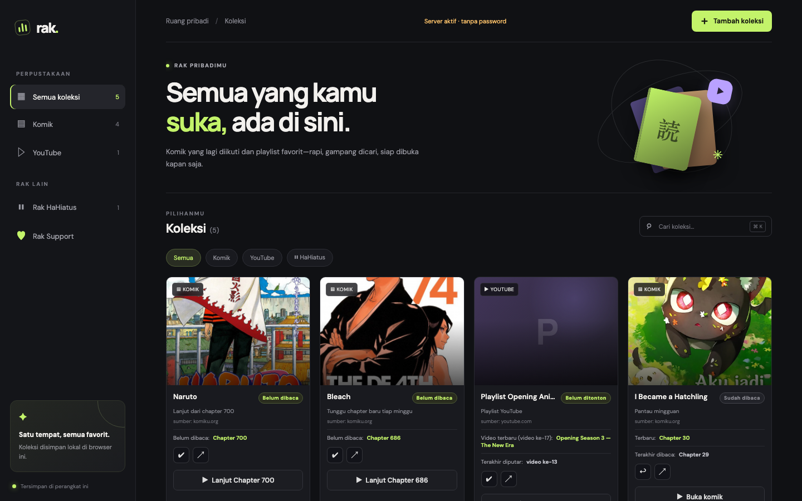
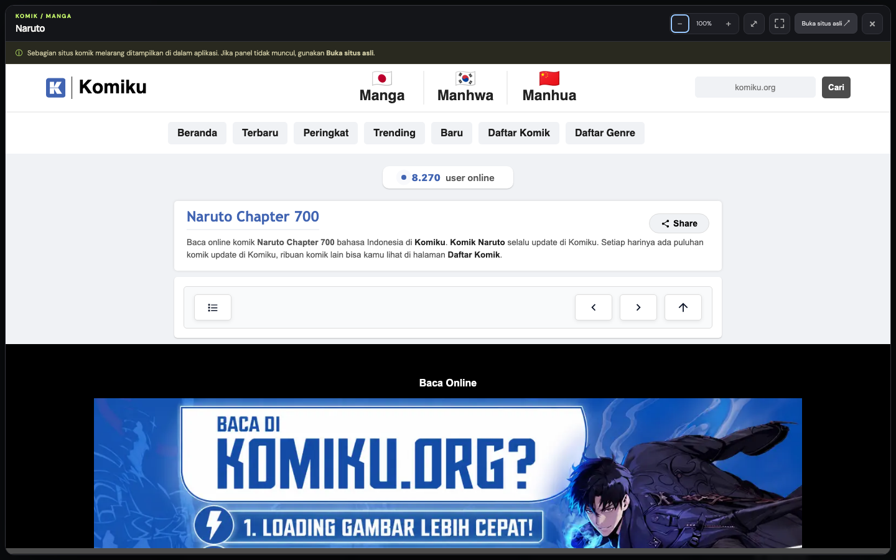
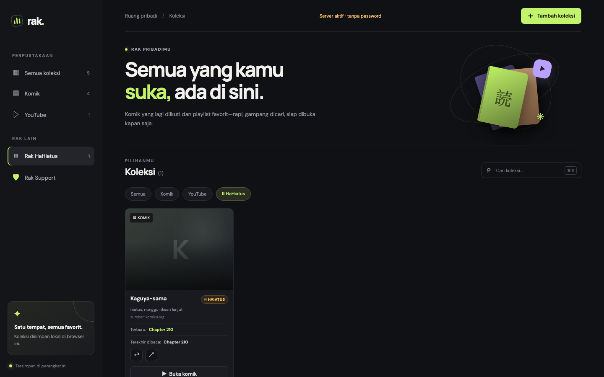
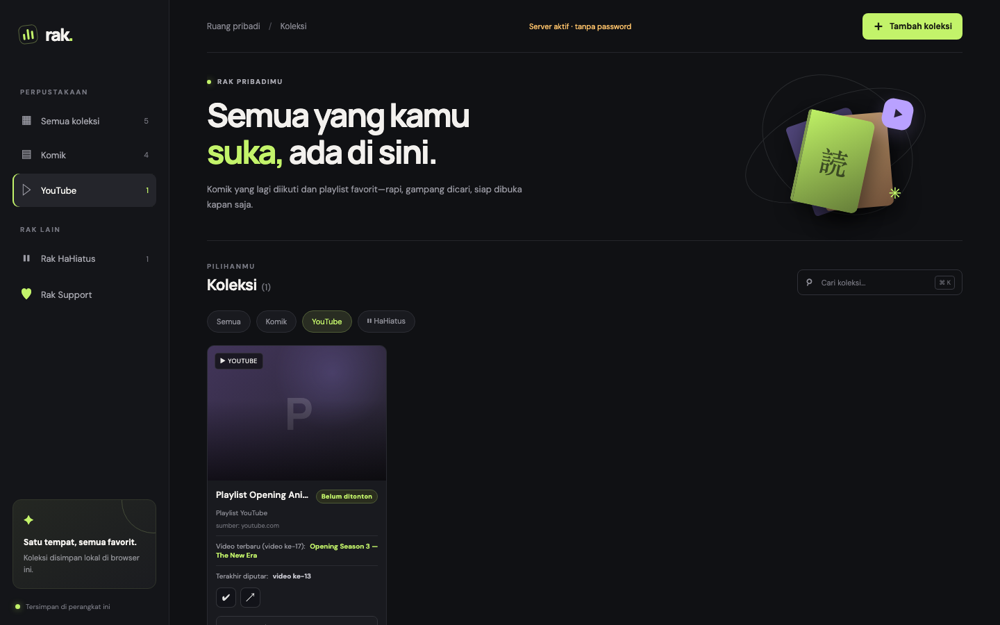
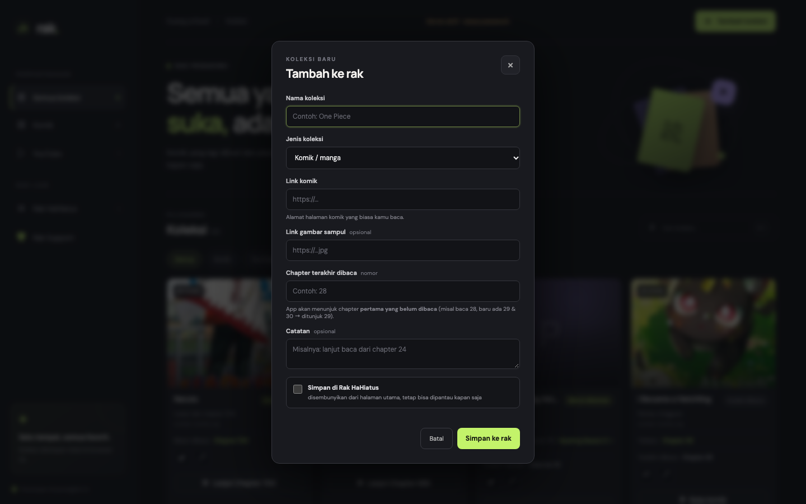
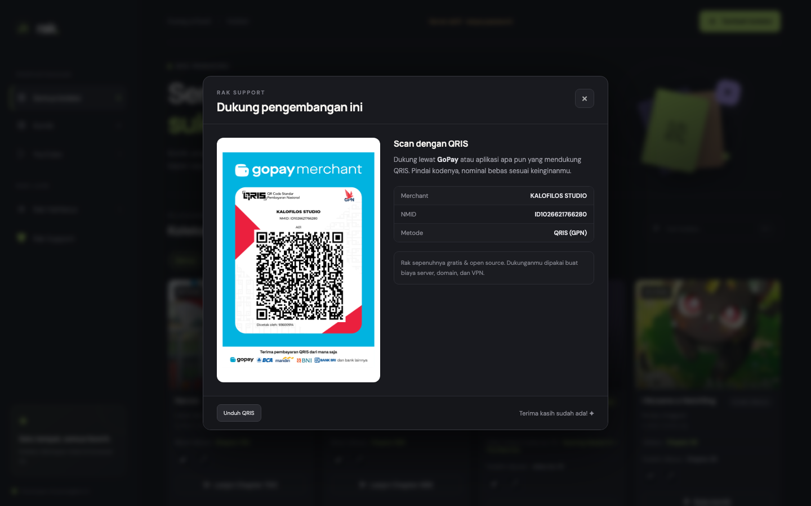

# Rak — Komik & YouTube

[](https://github.com/mrofiq466/rak-center/releases)
[](LICENSE)
[](https://nodejs.org)

Dashboard lokal untuk menyimpan tautan komik dan playlist YouTube di satu tempat.
Versi ini dilengkapi **server lokal kecil** yang berjalan di komputer kamu, sehingga:

- Koleksi dan riwayat bacaan disimpan di `data/db.json` pada perangkat kamu (bukan di situs asli).
- Tombol **Perbarui** mengambil chapter terbaru dari situs komik yang kamu daftarkan lewat server.
- Koleksi yang **belum dibaca** dan yang **terbaru diperbarui** ditampilkan di atas setiap kali halaman dimuat ulang.
- Tandai komik sebagai **Sudah dibaca** / **Belum dibaca**.
- **Rak HaHiatus** untuk komik yang sedang disingkirkan dari halaman utama.
- **Rak Support** berisi kode QRIS untuk dukungan pengembangan aplikasi ini.
- Gambar sampul diambil melalui proxy agar tautan WebP dari situs lain tetap bisa ditampilkan di aplikasi.

> **Tanpa akun, tanpa cloud, tanpa telemetri.** Semua data tinggal di komputermu.

## Tampilan

### Dashboard utama

Kartu untuk tiap komik dan playlist, lengkap dengan status baca, chapter yang perlu
dibaca, dan sumbernya.



### Chapter yang belum dibaca

Kalau sudah baca Chapter 28 lalu ada Chapter 29 dan 30, aplikasi menunjuk **Chapter 29** —
bukan melompat ke yang paling baru. Tombol **Lanjut Chapter 29** langsung membuka chapter itu.



Panel bacanya memenuhi layar. Ada zoom (35%–300%), tombol paskan lebar, dan layar penuh.
Pintasan keyboard: `+` `−` zoom, `0` reset, `F` layar penuh, `W` paskan lebar, `Esc` tutup.

### Filter dan Rak HaHiatus

Pisahkan komik yang lagi disingkirkan supaya tidak memenuhi halaman utama.



### Playlist YouTube

Diputar dari video terbaru, dengan antrean playlist tetap aktif.



### Tambah koleksi



### Kode QRIS



## Menjalankan di Mac

1. Buka Terminal.
2. Masuk ke folder aplikasi:

   ```sh
   cd ~/manga-playlist-hub
   ```

3. Instal dependensi (sekali saja):

   ```sh
   npm install
   ```

4. Jalankan server:

   ```sh
   npm start
   ```

5. Buka [http://localhost:3000](http://localhost:3000) di browser.
6. Biarkan Terminal tetap aktif selama memakai aplikasi. Tekan `Control+C` untuk menghentikan server.

### Linux dan Windows

```sh
git clone https://github.com/mrofiq466/rak-center.git
cd rak-center
npm install
npm start
```

Butuh **Node.js 18+** ([unduh](https://nodejs.org)). Perintah yang sama berlaku di PowerShell maupun CMD.

## Opsi lanjutan

| Perintah | Kegunaan |
|---|---|
| `npm run dev` | Server otomatis memuat ulang saat kode diubah |
| `npm test` | Uji keamanan (SSRF, prototype pollution, kebocoran berkas) dan autentikasi |
| `npm run test:browser` | Uji kompatibilitas di **Chrome dan Firefox** |
| `npm run test:e2e` | Uji end-to-end di browser (butuh Chrome) |
| `npm run test:reader` | Uji panel baca (tinggi, zoom, iframe) |
| `npm run test:login` | Uji halaman login di browser |
| `npm run test:support` | Uji Rak Support (QRIS) |
| `npm run test:youtube` | Uji playlist YouTube (opsional: `npm run test:youtube -- <playlistId>`) |
| `npm run reset` | Hapus semua koleksi, riwayat, dan password |

### Uji di Firefox

Pengujian browser memakai **Firefox milikmu sendiri** (bukan build terpisah), jadi
hasilnya persis sama dengan yang kamu pakai untuk membaca komik. Firefox dikendalikan
lewat `geckodriver`:

```sh
brew install geckodriver     # sekali saja (macOS/Linux)
npm run test:browser         # Chrome + Firefox
npm run test:browser firefox # hanya Firefox
```

Di Linux: `sudo apt install firefox-geckodriver`. Di Windows: unduh dari
[GitHub geckodriver](https://github.com/mozilla/geckodriver/releases).

> **Catatan:** aplikasi Rak sendiri **tidak butuh** paket npm tambahan untuk
> Firefox. Panel bacanya hanya `<iframe>` biasa yang jalan di browser mana pun.
> Paket `selenium-webdriver` hanya untuk *pengujian otomatis*.

## Panel baca

Panel baca dibuat **memenuhi layar** (bukan dialog kecil di tengah), dengan kendali berikut:

| Kontrol | Fungsi |
|---|---|
| `−` / `+` | Perkecil atau perbesar tampilan (35%–300%) |
| `⤢` atau `W` | Paskan lebar chapter |
| `⛶` atau `F` | Layar penuh |
| `0` | Reset zoom ke 100% |
| `Esc` | Tutup panel |

Level zoom tersimpan otomatis di browser, jadi pengaturanmu tetap sama saat aplikasi dibuka lagi.

## Konfigurasi

Semua pengaturan ditulis di file `.env` (sudah masuk `.gitignore`).

| Variabel | Bawaan | Arti |
|---|---|---|
| `HOST` | `0.0.0.0` | Alamat listen. `127.0.0.1` hanya untuk perangkat ini. |
| `PORT` | `3000` | Port server |
| `RAK_PASSWORD` | acak | Password Rak. Dibuat otomatis dan ditampilkan di terminal saat pertama jalan. |
| `RAK_NO_AUTH` | `0` | Isi `1` untuk mematikan password (jangan di server publik). |
| `RAK_TOKEN` | kosong | Token untuk akses programatik lewat header `X-Rak-Token`. |
| `RAK_QRIS_FILE` | `qris.png` | Nama berkas gambar QRIS. |
| `RAK_DATA_DIR` | `./data` | Folder penyimpanan data. |
| `RAK_ALLOW_PRIVATE_FETCH` | `0` | Isi `1` hanya jika aplikasi memang perlu menjangkau alamat internal. |

Salin `.env.example` sebagai titik awal.

## Keamanan

Server dilindungi **password** dan selalu mendengarkan di `0.0.0.0` supaya siap
dijangkau dari server dan Cloudflare Tunnel. Password dibuat otomatis dan
ditampilkan di terminal saat pertama jalan, atau bisa ditetapkan sendiri lewat
`RAK_PASSWORD` di `.env`.

- Password disimpan sebagai **hash scrypt** (bukan plaintext) di `data/auth.json`.
- Sesi memakai **cookie HttpOnly + SameSite=Strict** bertanda tangan HMAC (berlaku 14 hari).
- Halaman login: `/login`. API menolak semua permintaan tanpa sesi valid.
- Login dibatasi **12 percobaan per 15 menit** untuk setiap IP (anti brute force).
- Proxy gambar dan scraping komik dilindungi guard anti-SSRF (menolak IP privat, loopback, dan cloud metadata), ukuran permintaan dibatasi 256 KB, dan berkas proyek tidak bisa diunduh lewat HTTP.

### Mematikan password (sementara)

Kalau mau pakai tanpa password — misalnya saat masih dalam pengembangan — set di `.env`:

```env
RAK_NO_AUTH=1
```

Aplikasi langsung terbuka tanpa halaman login, dan badge di kanan atas berubah jadi
**kuning: "Server aktif · tanpa password"**. Terminal juga mencetak peringatan.

> ⚠️ **Jangan** pakai `RAK_NO_AUTH=1` kalau server sudah bisa dijangkau dari internet.
> Ubah kembali menjadi `RAK_NO_AUTH=0` (atau hapus barisnya) sebelum deploy ke server publik.

Untuk pemakaian lokal tanpa password, alternatifnya set `HOST=127.0.0.1` di `.env`.

Panduan lengkap untuk server dan Cloudflare Tunnel ada di **[DEPLOY.md](DEPLOY.md)**.
Rincian model ancaman ada di **[SECURITY.md](SECURITY.md)**.

## Kalau mau berkontribusi

```sh
git clone https://github.com/mrofiq466/rak-center.git
cd rak-center
npm install
npm start          # terminal 1
npm test           # terminal 2 — uji keamanan
node test-e2e.js   # uji end-to-end
```

Panduan singkat untuk kontributor ada di [CONTRIBUTING.md](CONTRIBUTING.md).

## Cara kerja

- **Tambah koleksi:** isi nama, pilih jenis (Komik atau YouTube), lalu masukkan tautannya. Untuk komik, gunakan tautan halaman komik yang kamu ikuti. Untuk YouTube, gunakan tautan playlist.
- **Perbarui dari sumber (↻):** server mengambil daftar chapter dari situs komik, lalu menentukan **chapter pertama yang belum kamu baca**.
  - Contoh: kamu sudah baca **Chapter 28**, lalu ada Chapter 29 dan 30 → aplikasi menunjuk **Chapter 29** (bukan langsung ke 30).
  - Kalau kamu belum pernah menandai apa pun, aplikasi menunjuk chapter terbaru.
  - Chapter terakhir dibaca juga bisa diisi manual di form Edit (kolom **Chapter terakhir dibaca**).
- **Rak HaHiatus (⏸):** komik yang sudah lama tidak update atau sedang kamu istirahatkan bisa dipindahkan ke rak terpisah lewat ikon **⏸** (atau centang "Simpan di Rak HaHiatus" saat menambah atau mengedit). Item di rak ini **tidak muncul di halaman utama**, tapi tetap bisa dipantau lewat menu **Rak HaHiatus** di sidebar. Klik ⏸ lagi untuk mengembalikannya.
- **Peringatan lama tidak update:** server membaca tanggal rilis chapter terbaru. Kalau sudah lebih dari 30 hari, muncul badge **"⏸ sudah N hari tidak update"** di kartu — sinyal untuk memindahkan ke Rak HaHiatus.
- **Ganti sumber atau mirror (⇄):** kalau situs komik sedang down atau kamu mau pindah ke mirror lain, klik ikon ⇄ lalu tempel tautan baru. **Riwayat baca tetap ikut** (nomor chapter terakhir dibaca tidak hilang) dan daftar chapter otomatis dideteksi ulang dari situs baru. Tautan chapter lama ke domain sebelumnya dibuang otomatis.
- **Buka di dalam aplikasi:** kartu komik membuka **langsung ke chapter yang belum dibaca**. Playlist YouTube diputar di dalam aplikasi **mulai dari video terbaru**, dengan antrean playlist tetap aktif.
- **Video terbaru di YouTube:** server membaca metadata umur tiap video ("4 jam lalu", "3 hari lalu") lalu memilih yang paling baru. Ini penting karena playlist *uploads* (prefiks `UU`) menaruh video terbaru di **depan**, sedangkan playlist manual (prefiks `PL`) menaruhnya di **belakang** — jadi tidak bisa asal ambil video terakhir. Posisi videonya juga ditampilkan ("video ke-100").
- **Status YouTube:** memakai label "Belum ditonton" dan "Sudah ditonton" (bukan "Chapter"), serta mencatat video terakhir yang diputar.
- **Tandai dibaca (✔):** chapter yang ditunjuk dianggap selesai dibaca, nomor kemajuan naik, dan kartu turun ke bawah kalau sudah sampai chapter terbaru.
- **Tandai belum dibaca (↩):** kartu naik ke atas lagi tanpa mengubah kemajuan baca.
- **Kartu menampilkan:** sampul, status (Belum dibaca / Sudah dibaca), sumber aktif (domain), chapter yang perlu dibaca, dan chapter terakhir dibaca.
- **Gambar:** dimuat lewat proxy lokal (`/api/image-proxy`) supaya tautan WebP dari situs lain tetap bisa tampil.
- **Riwayat dan data:** tersimpan otomatis di `data/db.json`. **Sepenuhnya lokal** — tidak ada yang disimpan di situs komik maupun YouTube. Jangan hapus folder `data` kalau ingin mempertahankan koleksi.

## Batasan penting

- Deteksi chapter bersifat **best-effort** (sebebas mungkin) dan bergantung pada struktur HTML tiap situs komik. Untuk situs lain, isi manual kolom **Chapter terakhir dibaca**.
- YouTube tanpa API key hanya bisa mengambil judul playlist dan urutan video dari halaman publik. Urutan asli playlist tidak diubah.
- Beberapa situs komik melarang ditampilkan dalam iframe (`X-Frame-Options`). Aplikasi menyediakan tombol **Buka situs asli** sebagai alternatif.

## Menghentikan dan menghapus data

- Menghentikan server: tekan `Control+C` di Terminal.
- Menghapus semua koleksi, riwayat, dan password: jalankan `npm run reset`, atau hapus
  `data/db.json` dan `data/auth.json` lalu nyalakan ulang server.

## Pengujian

Seluruh skrip uji menjalankan pemeriksaan yang sama di browser sungguhan.

```sh
npm start                       # jalankan di terminal terpisah
npm test                        # keamanan + autentikasi (memicu server sendiri)
npm run test:browser            # Chrome dan Firefox
node test-e2e.js                # tambah koleksi + Rak HaHiatus
node test-login-ui.js           # halaman login
node test-reader.js             # panel baca
node test-support.js            # Rak Support (QRIS)
node test-youtube.js <playlistId>  # playlist YouTube (opsional: id playlist)
```

Butuh Google Chrome (Puppeteer) dan `geckodriver` (Selenium untuk Firefox).
