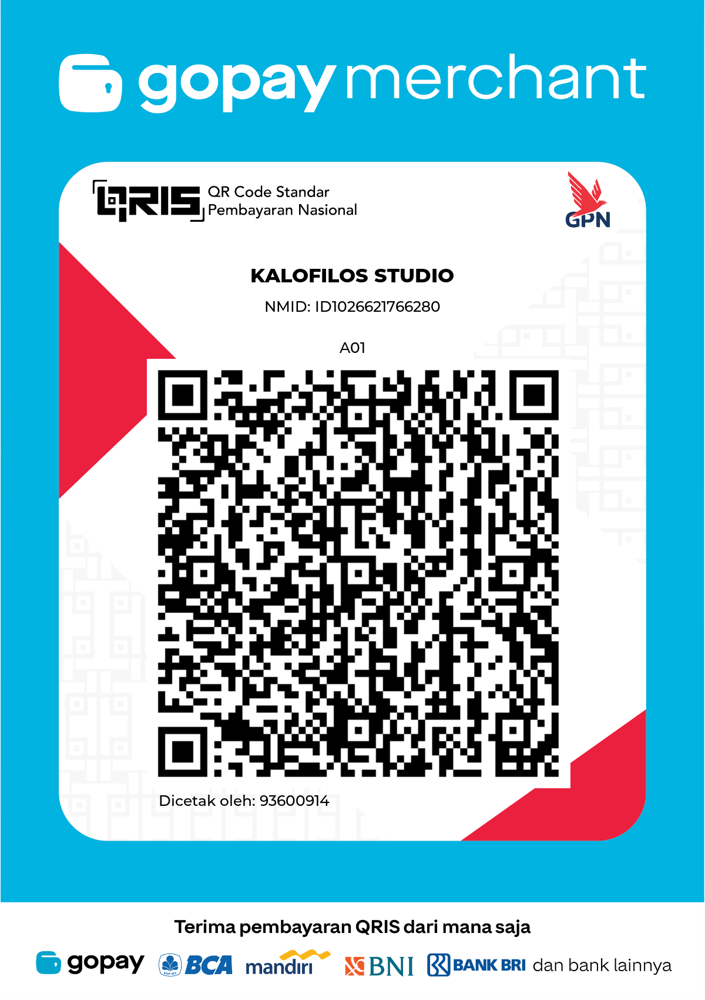

# Rak — Komik & YouTube

[](https://github.com/mrofiq466/rak-center/releases)
[](LICENSE)
[](https://nodejs.org)

Dashboard lokal untuk menyimpan tautan komik dan playlist YouTube di satu tempat. Versi ini dilengkapi **server lokal kecil** yang berjalan di komputer kamu, sehingga:

- Koleksi dan riwayat bacaan disimpan di `data/db.json` pada perangkat kamu (bukan di situs asli).
- Tombol **Perbarui** mengambil chapter terbaru dari situs komik yang kamu daftarkan via backend.
- Koleksi yang **belum dibaca** dan yang **terbaru diperbarui** ditampilkan di atas setiap kali refresh.
- Tandai komik sebagai **Sudah dibaca** / **Belum dibaca**.
- **Rak HaHiatus** untuk komik yang sedang disingkirkan dari halaman utama.
- **Rak Support** berisi kode QRIS untukukung pengembangan app ini.
- Gambar sampul diambil melalui proxy agar link WebP dari situs lain tetap bisa ditampilkan di app.

> **Tanpa akun, tanpa cloud, tanpa telemetri.** Semua data tinggal di komputermu.

## Tampilan

### Dashboard utama

Kartu untuk tiap komik & playlist, dengan status baca, chapter yang perlu dibaca, dan sumbernya.


### Chapter yang belum dibaca

Kalau sudah baca Chapter 28 lalu ada Chapter 29 & 30, app menunjuk **Chapter 29** —
bukan lompat ke yang paling baru. Tombol **Lanjut Chapter 29** langsung membuka chapter itu.


Panel bacanya memenuhi layar, dengan zoom (35%–300%), paskan lebar, dan layar penuh.
Pintasan keyboard: `+` `−` zoom, `0` reset, `F` layar penuh, `W` paskan lebar, `Esc` tutup.

### Filter & Rak HaHiatus

Pisahkan komik yang lagi disingkirkan supaya tidak memenuhi halaman utama.


### Playlist YouTube

Diputar dari video terbaru, dengan antrean playlist tetap aktif.


### Tambah koleksi


### Rak Support


## Rak Support ♡

Rak ini gratis, open source, dan tidak pernah mengirim data keluamu ke mana pun.
Kalau kamu merasa app ini membantu, kamu bisa dukung lewat QRIS — pakai buat biaya
server, domain, dan VPN.

<p align="center">
  
</p>

**Scan dengan GoPay** (atau aplikasi apa pun yang mendukung QRIS).
Merchant: **KALOFILOS STUDIO** · NMID: `ID1026621766280`

Di dalam aplikasinya, kode yang sama bisa dibuka lewat menu **Rak Support** di
sidebar.

<details>
<summary>Ganti QRIS dengan milikmu sendiri (untuk fork)</summary>

Taruh file QRIS-mu di folder app dengan nama `qris.png`, atau tentukan nama file
lain lewat environment variable:

```env
RAK_QRIS_FILE=qris.png
```

Kalau file-nya tidak ada, aplikasi tetap jalan normal — Rak Support hanya
menampilkan pesan bahwa file belum tersedia.

</details>


## Menjalankan di Mac

1. Buka Terminal.
2. Masuk ke folder app:

   ```sh
   cd ~/manga-playlist-hub
   ```

3. Instal dependensi (satu kali saja):

   ```sh
   npm install
   ```

4. Jalankan server:

   ```sh
   npm start
   ```

5. Buka [http://localhost:3000](http://localhost:3000) di browser.
6. Biarkan Terminal tetap aktif saat memakai app. Tekan `Control+C` untuk menghentikan server.

### Linux & Windows

```sh
git clone <url-repo-ini>
cd rak-komik-youtube
npm install
npm start
```

Butuh **Node.js 18+** ([unduh](https://nodejs.org)). Perintah yang sama berlaku di PowerShell/CMD.

## Opsi lanjutan

| Perintah | Kegunaan |
|---|---|
| `npm run dev` | Server auto-reload saat kode diubah |
| `npm test` | Uji keamanan (SSRF, prototype pollution, kebocoran berkas) + autentikasi |
| `npm run test:browser` | Uji kompatibilitas di **Chrome & Firefox** |
| `npm run test:e2e` | Uji end-to-end di browser (butuh Chrome) |
| `npm run test:reader` | Uji panel baca (tinggi, zoom, iframe) |
| `npm run test:login` | Uji halaman login di browser |
| `npm run test:support` | Uji Rak Support (QRIS) |
| `npm run reset` | Hapus semua koleksi & riwayat |

### Uji di Firefox

Uji browser memakai **Firefox milikmu sendiri** (bukan build terpisah), jadi hasilnya
persis sama dengan yang kamu pakai untuk membaca komik. Firefox dib automating lewat
`geckodriver`:

```sh
brew install geckodriver     # sekali saja (macOS/Linux)
npm run test:browser         # Chrome + Firefox
npm run test:browser firefox # hanya Firefox
```

Di Linux: `sudo apt install firefox-geckodriver`. Di Windows: unduh dari
[GitHub geckodriver](https://github.com/mozilla/geckodriver/releases).

> **Catatan:** aplikasi Rak sendiri **tidak butuh** paket npm tambahan untuk
> Firefox. Panel bacanya cuma `<iframe>` biasa yang jalan di browser mana pun.
> Paket `selenium-webdriver` hanya untuk *pengujian otomatis*.

## Panel baca

Panel baca dibuat **memenuhi layar** (bukan dialog kecil di tengah), plus:

| Kontrol | Fungsi |
|---|---|
| `−` / `+` | Perkecil / perbesar tampilan (35% – 300%) |
| `⤢` atau `W` | Paskan lebar chapter |
| `⛶` atau `F` | Layar penuh |
| `0` | Reset zoom ke 100% |
| `Esc` | Tutup panel |

Level zoom tersimpan otomatis di browser, jadi pengaturanmu tetap sama saat app dibuka lagi.

## Keamanan

Server dilindungi **password** dan selalu mendengarkan di `0.0.0.0` supaya siap
dijangkau dari server + Cloudflare Tunnel. Password dibuat otomatis dan
ditampilkan di terminal saat pertama jalan, atau bisa ditetapkan sendiri lewat
`RAK_PASSWORD` di `.env`.

- Password disimpan sebagai **hash scrypt** (bukan plaintext) di `data/auth.json`.
- Sesi memakai **cookie HttpOnly + SameSite=Strict** bertanda tangan HMAC (berlaku 14 hari).
- Halaman login: `/login`. API menolak semua request tanpa sesi valid.
- Login dibatasi **12 percobaan / 15 menit** per IP (anti brute force).
- Proxy gambar dan scrape komik dilindungi guard anti-SSRF (menolak IP privat, loopback, cloud metadata), ukuran request dibatasi 256 KB, dan berkas proyek tidak bisa diunduh lewat HTTP.

### Matikan password (sementara)

Kalau mau pakai tanpa password — misalnya saat masih development — set di `.env`:

```env
RAK_NO_AUTH=1
```

Aplikasi langsung terbuka tanpa halaman login, dan badge di kanan atas berubah jadi
**kuning: "Server aktif · tanpa password"**. Terminal juga Prints peringatan.

> ⚠️ **Jangan** pakai `RAK_NO_AUTH=1` kalau server sudah bisa dijangkau internet.
> Setel kembali `RAK_NO_AUTH=0` (atau hapus barisnya) sebelum deploy ke server publik.

Untuk pemakaian lokal tanpa password, alternatifnya set `HOST=127.0.0.1` di `.env`.

Panduan lengkap untuk server + Cloudflare Tunnel ada di **[DEPLOY.md](DEPLOY.md)**.
Rincian model ancaman ada di **[SECURITY.md](SECURITY.md)**.

## Kalau mau contribute

```sh
git clone <url-repo-ini>
cd rak-komik-youtube
npm install
npm start          # terminal 1
npm test           # terminal 2 — uji keamanan
node test-e2e.js   # uji end-to-end
```

Panduan singkat untuk contributor ada di [CONTRIBUTING.md](CONTRIBUTING.md).

## Cara kerja

- **Tambah koleksi:** isi nama, pilih jenis (Komik atau YouTube), masukkan link. Untuk komik, masukkan link halaman komik yang kamu ikuti. Untuk YouTube, masukkan link playlist.
- **Perbarui dari sumber (↻):** server mengambil daftar chapter dari situs komik, lalu menentukan **chapter pertama yang belum kamu baca**.
  - Contoh: kamu sudah baca **Chapter 28**, lalu ada Chapter 29 & 30 → app menunjuk **Chapter 29** (bukan langsung ke 30).
  - Kalau kamu belum pernah menandai apa pun, app menunjuk chapter terbaru.
  - Chapter terakhir dibaca juga bisa diisi manual di form Edit (kolom **Chapter terakhir dibaca**).
- **Rak HaHiatus (⏸):** komik yang sudah lama tidak update atau sedang kamu istirahatkan bisa dipindahkan ke rak terpisah lewat ikon **⏸** (atau centang "Simpan di Rak HaHiatus" saat tambah/edit). Item di rak ini **tidak muncul di halaman utama**, tapi tetap bisa dipantau lewat menu **Rak HaHiatus** di sidebar. Klik ⏸ lagi untuk mengembalikannya.
- **Peringatan lama tidak update:** server membaca tanggal rilis chapter terbaru. Kalau sudah lebih dari 30 hari, muncul badge **"⏸ sudah N hari tidak update"** di kartu — sinyal untuk memindahkan ke Rak HaHiatus.
- **Ganti sumber / mirror (⇄):** kalau situs komik down atau kamu mau pindah mirror, klik ikon ⇄ lalu tempel URL baru. **Riwayat baca tetap ikut** (nomor chapter terakhir dibaca tidak hilang) dan chapter otomatis dideteksi ulang dari situs baru. Link chapter lama ke domain sebelumnya dibuang otomatis.
- **Buka di dalam app:** kartu komik membuka **langsung ke chapter yang belum dibaca**. Playlist YouTube diputar di dalam app **mulai dari video terbaru**, dengan antrean playlist aktif.
- **Video terbaru di YouTube:** server membaca metadata umur tiap video ("4 jam lalu", "3 hari lalu") lalu memilih yang paling baru. Ini penting karena playlist *uploads* (prefix `UU`) menaruh video terbaru di **depan**, sedangkan playlist manual (prefix `PL`) menaruhnya di **belakang** — jadi tidak bisa asal ambil video terakhir. Posisi video juga ditampilkan ("video ke-100").
- **Status YouTube:** memakai label "Belum ditonton" / "Sudah ditonton" (bukan "Chapter"), dan mencatat video terakhir diputar.
- **Tandai dibaca (✔):** chapter yang ditunjuk dianggap selesai dibaca, nomor progress maju, dan kartu turun ke bawah kalau sudah caught up.
- **Tandai belum dibaca (↩):** kartu naik ke atas lagi tanpa mengubah progress.
- **Kartu menampilkan:** sampul, status (Belum dibaca / Sudah dibaca), sumber aktif (domain), chapter yang perlu dibaca, dan chapter terakhir dibaca.
- **Gambar:** dimuat lewat proxy lokal (`/api/image-proxy`) supaya link WebP dari situs lain tetap bisa tampil.
- **Riwayat & data:** tersimpan otomatis di `data/db.json`. **Fully lokal** — tidak ada yang disimpan di situs komik maupun YouTube. Jangan hapus folder `data` kalau ingin mempertahankan koleksi.

## Batasan penting

- Deteksi chapter adalah **best-effort** dan bergantung pada struktur HTML tiap situs komik. Untuk situs lain, isi manual kolom **Chapter terakhir dibaca**.
- YouTube tanpa API key hanya bisa mengambil judul playlist dan urutan video dari halaman publik. Urutan asli playlist tidak diubah.
- Beberapa situs komik melarang ditampilkan dalam iframe (`X-Frame-Options`). App menyediakan tombol **Buka situs asli** sebagai alternatif.

## Menghentikan / Menghapus data

- Menghentikan: `Control+C` di Terminal.
- Menghapus semua data: hapus file `data/db.json` kemudian nyalakan ulang server.

## Pengujian

`test-e2e.js` dan `test-youtube.js` menjalankan uji end-to-end otomatis (butuh Google Chrome yang sudah terpasang):

```sh
npm start                          # jalankan di terminal terpisah
node test-e2e.js                   # uji tambah koleksi + Rak HaHiatus
node test-youtube.js <playlistId>  # uji playlist YouTube (opsional: id playlist)
```
